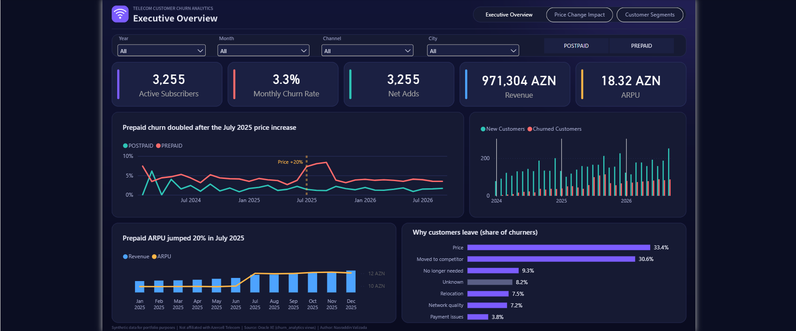
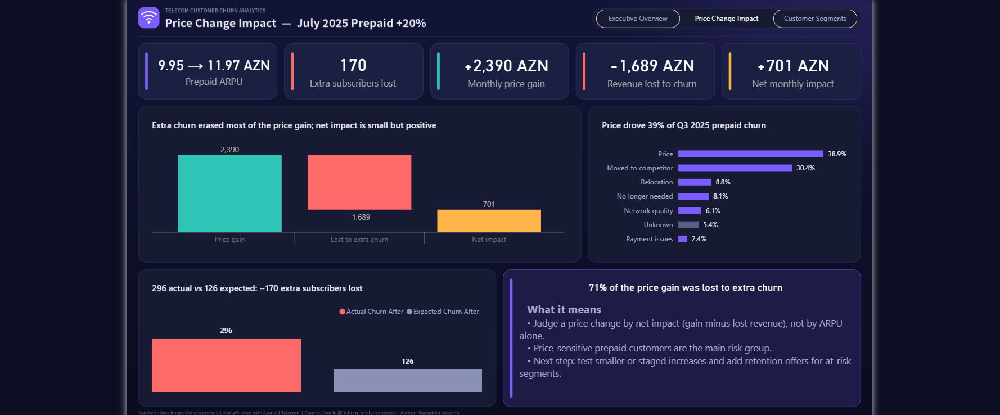
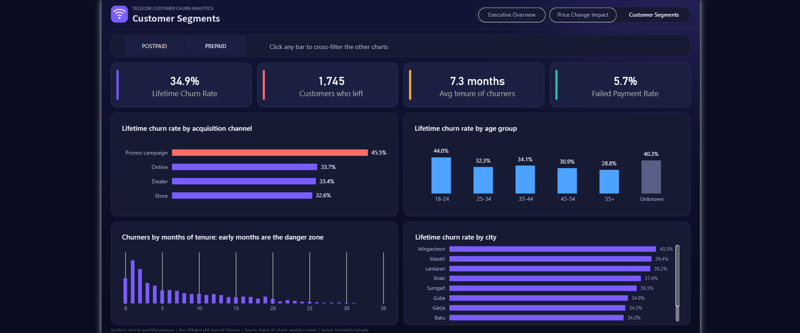

# Telecom Customer Churn Analysis

**Oracle SQL, Python and Power BI** | end-to-end analytics project on a mobile operator's subscriber base

> **Data disclaimer:** all data in this repository is **synthetic**. It is not real customer data and the project is not affiliated with Azercell Telecom or any other operator. Tariff names and prices are fictional.



## Business question

A mobile operator raised prepaid prices by 20% in July 2025 and then noticed more subscribers leaving. This project answers four questions:

1. How is churn really measured, and how has it changed month by month?
2. Did the price increase cause the spike, and in which segment?
3. Was the price increase profitable once lost subscribers are counted?
4. Which customers are most at risk (channel, age, tenure, tariff type, city)?

## Key findings

| # | Finding | Evidence |
|---|---------|----------|
| 1 | Counting `status = 'CANCELLED'` overstates churn by **33%**: it counts customers who simply upgraded to a bigger tariff | 2,319 cancelled subscriptions vs **1,745** customers who actually left |
| 2 | After the July 2025 price increase, **prepaid** monthly churn rose from about 3-4% to **7.3-8.4%** for three months. Postpaid (price unchanged) stayed at 1-2% | 2024 summer shows no spike, so it is not seasonality |
| 3 | "Price" became the top reason for leaving: **27% to 39%** of prepaid churners | 296 churners in Jul-Sep 2025 vs 126 expected at the pre-increase rate: about **170 extra** |
| 4 | The increase was profitable, but only barely: **+2,390 AZN/month** price gain minus **1,689 AZN/month** lost revenue = **+701 AZN/month** net. About **71%** of the gain was lost to extra churn | ARPU 9.95 to 11.97 AZN |
| 5 | Highest-risk segments: **Promo-campaign** customers (45.5% lifetime churn vs 32.6-33.7% for other channels), **ages 18-24** (44.0% vs 28.8% for 55+), **prepaid** (41.4% vs 19.4% postpaid). Most churn happens in months 1-2. City is a weak driver (30.6-40.3%) | Customer Segments page |




## Architecture

```
Python (data simulation)  ->  Oracle XE tables  ->  SQL reporting views  ->  Power BI (Import mode)
generate_customers.py          customers               v_customer_churn         star schema,
generate_activity.py           subscriptions           v_monthly_churn          DAX measures,
                               payments                v_monthly_revenue        3-page dashboard
                               usage_monthly           v_price_impact
                               plans
```

* **Business logic lives in the database.** The churn definition, revenue rules and price-impact method are written once in SQL views, so every report shows the same numbers.
* **Everything is dynamic.** Python reads customers and tariffs from the database; views take the observation date and month list from the data; Power BI connects to the views and refreshes with one click. Nothing is hard-coded except the documented price-change date.
* Power BI measures use `DIVIDE`, `REMOVEFILTERS`, `SELECTEDVALUE` and semi-additive logic (active subscribers take the last month of the selected period instead of summing).


## Repository structure

```
sql/
  setup/        00_create_user, 01_create_tables, 02_insert_plans
  analysis/     01_data_profiling            data profiling and churn definition
                02_customer_churn_view       ROW_NUMBER, v_customer_churn
                03_monthly_churn             monthly churn rate, prepaid vs postpaid
                04_churn_reasons             churn reasons before and after the price change
                05_revenue_impact            ARPU and net impact of the price change
                06_powerbi_views             reporting views for Power BI
                07_data_quality_checks       21 automated pass/fail checks
python/         db.py, generate_customers.py, generate_activity.py, test_connection.py
powerbi/        azercell_churn_dashboard.pbix, screenshots/, design/ (theme and page backgrounds)
```

## SQL and analytics techniques

* CTEs, `ROW_NUMBER()` and `SUM(COUNT(*)) OVER (PARTITION BY ...)` window functions
* Conditional aggregation, `NOT EXISTS` anti-join, `NVL`/`NULLIF`, date arithmetic (`TRUNC`, `ADD_MONTHS`, `MONTHS_BETWEEN`)
* Cohort month and tenure calculation, dynamic as-of date
* Baseline (counterfactual) comparison to isolate the effect of the price change
* Reconciliation checks between views and source tables

## Method notes

* **Churn definition:** a customer has churned if they have no `ACTIVE` subscription left. A tariff change closes the old subscription and opens a new one, so it is not churn.
* **Monthly churn rate** = customers who left in the month / active customers at the start of the month. Percentages are never averaged: Power BI measures divide summed counts.
* **Price impact:** gain = paying customers x ARPU difference. Loss = excess churn x pre-increase ARPU. Excess churn = actual churn minus the churn expected at the pre-increase monthly rate.
* **Lifetime churn rate** is used only to compare segments with each other, because older customers have had more time to leave.

## Data quality

`sql/analysis/07_data_quality_checks.sql` runs 21 pass/fail checks (orphans, overlapping subscriptions, status consistency, tariff-price rule, duplicate payments, text hygiene, view-to-source reconciliation). All 21 pass.

Known, documented gaps that were deliberately included to resemble real data: about 3% of customers have no age (shown as "Unknown") and about 6% of cancellations have no reason (shown as "Unknown").

## How to reproduce

**Requirements:** Oracle Database XE (21c or later), Python 3.10+, Power BI Desktop, Oracle SQL Developer (optional).

1. **Database:** as `SYSTEM` run `sql/setup/00_create_user.sql` (replace `CHANGE_ME`). Connect as `churn_analytics` and run `01_create_tables.sql` then `02_insert_plans.sql`.
2. **Python environment:**
   ```
   python -m venv .venv
   .venv\Scripts\activate
   python -m pip install -r requirements.txt
   ```
3. **Credentials:** copy `.env.example` to `.env` and fill in your values.
4. **Generate data:**
   ```
   python python/generate_customers.py
   python python/generate_activity.py
   ```
5. **Create views:** run `sql/analysis/02_customer_churn_view.sql` and `06_powerbi_views.sql` as `churn_analytics`, then `07_data_quality_checks.sql` to verify (expect 21 PASS).
6. **Dashboard:** open `powerbi/azercell_churn_dashboard.pbix` and point the Oracle source to your server (`localhost:1521/XEPDB1`), then **Refresh**.

## Limitations

* The data is simulated. The simulation deliberately contains a price shock, a promo-cohort effect and risk signals (failed payments, network complaints), so the findings demonstrate the **method and pipeline**, not facts about a real operator.
* The price-impact estimate is a before/after comparison against a baseline rate. A production analysis would add a control group or a statistical model.
* Part of the Promo-channel gap comes from tariff mix (84% of Promo customers are prepaid), although it also holds within each tariff type (prepaid 49.0% vs about 40%, postpaid 26.8% vs about 19%).

## Author

**Nasraddin Valizada** | Data Analyst
[LinkedIn](https://www.linkedin.com/in/nasraddin-valizada-36485127b/) | [GitHub](https://github.com/Valiyevvn)
